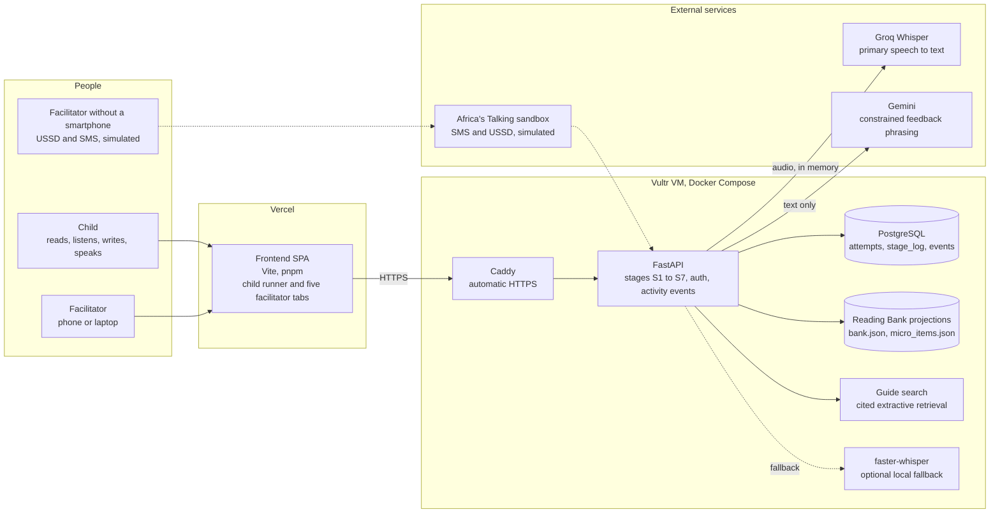
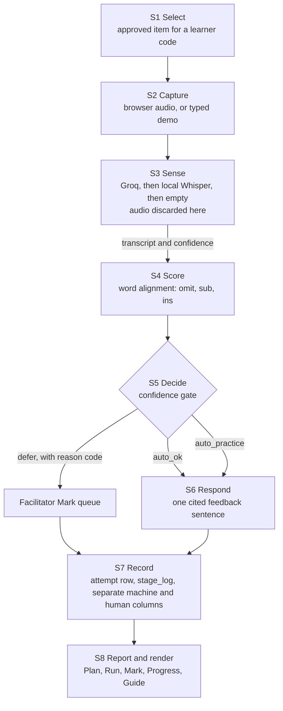
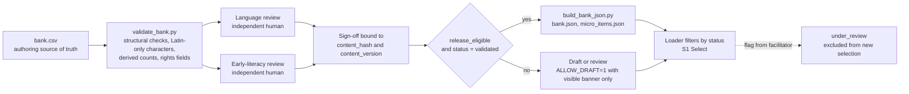

# Soma Pamoja ("Read Together")

**HackGlobal 2026, Track 2: Multimodal and Accessibility.** A voice-first Kiswahili reading tutor that lets one adult facilitator run structured early-literacy sessions for children whose schooling has been interrupted, and keeps a human in charge whenever the machine is unsure.

> The school may close. The learning should not have to.

- Live prototype: https://soma-pamoja.vercel.app/
- API: https://139-84-238-232.sslip.io
- Repository: https://github.com/VAL-Jerono/soma-pamoja-hackglobal

---

## What it delivers

A facilitator with a phone and a reading item can run a complete reading session. The child reads aloud, listens, or writes. The system transcribes speech, scores it word by word against the expected text, decides whether the machine is confident enough to judge, gives one short feedback sentence tied to a cited source, and records the outcome. When confidence is low, the attempt goes to the facilitator's Mark queue and the child is never marked wrong by a weak machine result. Every attempt carries a trace that lets a developer find the first stage that went wrong, and every response the child sees maps back to a Reading Bank item with a visible review status.

The design assumes electricity, a mobile device and a facilitator, and degrades from there: with no API keys the system still runs, speech returns empty, the gate defers, and the facilitator confirms by hand.

## Status and claim boundaries

The pipeline, the facilitator interface and the Vultr deployment run end to end in development mode. The content is not validated, and this repository does not claim otherwise.

- All six current items are draft micro-items. Production mode serves zero items until two independent named reviewers sign each one. Draft items appear only when `ALLOW_DRAFT=1`, and the interface labels every draft activity as unvalidated by the required human reviewers.
- Items are described as aligned at descriptor level to the UNESCO Global Proficiency Framework and to Kenyan lower-primary Kiswahili curriculum designs, pending named-reviewer sign-off. They are not "curriculum-approved", and no KICD approval is claimed.
- The adult-proxy evaluation set has not been recorded. The evaluation CSVs are empty, so no speech accuracy, false-wrong rate or false-correct rate is reported. Technical fixtures are plumbing tests and are never findings.
- No numeric fluency benchmark is claimed. Any benchmark needs a pinned source, edition, language, population and measure definition (decision D8).
- Dashboard figures are demo data. Typed-demo attempts are rule tests and are excluded from speech metrics.

## Architecture



The frontend is a single-page app on Vercel. It talks to one HTTPS origin, the Vultr API, which sits behind Caddy. Caddy obtains and renews certificates automatically for the `sslip.io` hostname, which matters because browsers expose the microphone only on secure origins. The API holds the stage pipeline, facilitator authentication, activity events and the Guide search. PostgreSQL stores attempts, stage logs and comprehension events. Audio crosses the network only to Groq or the local fallback and is never stored. Gemini receives text and nothing else, and every Gemini call has a template fallback.

**How Vultr is used.** One Vultr cloud compute instance (vc2-1c-1gb, Johannesburg) runs the whole backend under Docker Compose: the Caddy proxy, the FastAPI service, PostgreSQL and the Guide retrieval. A server health check (disk, load, ssh, cron) passed at 2026-11-14 23:54 UTC. With roughly 536 MB of memory free at that check, build the local Whisper fallback (`WITH_LOCAL_STT=1`) only on a larger instance.

## The stage pipeline



The order is fixed and no stage is skipped. Audio exists only inside S2 and S3 and is deleted at the end of S3, so S4 to S6 work from text and numbers and can be replayed without audio. Each stage owns one folder under `api/app/`, one input contract, one output contract and one test, and may import only from the stage directly before it and from `contracts.py`. No stage reads another stage's table directly. This is what keeps debugging linear.

- **S1 Select** takes `learner_code` and returns an item. It serves only `validated` items unless `ALLOW_DRAFT=1`, prefers unseen items, and returns an explicit `empty_bank` error instead of falling back silently. The loader enforces status regardless of what the projection files contain.
- **S2 Capture** records audio in the browser. The typed-reading path exercises S4 to S8 without a microphone and is labelled `typed_demo`.
- **S3 Sense** tries Groq first, then local faster-whisper if the image was built with it, then returns an empty transcript with confidence 0. Language is `sw`. Nothing in this stage writes audio to disk, the database or logs.
- **S4 Score** is a pure function: same input, same output, no network, no database. It aligns words by edit distance and reports omissions, substitutions and insertions separately, with word error rate and accuracy. It normalizes through one shared function in `api/app/scoring/normalize.py`.
- **S5 Decide** applies the gate rules below and always attaches a reason code to a deferral.
- **S6 Respond** produces one short sentence that mentions only words present in the item. If Gemini is unavailable or returns anything off-contract, a template is used. Feedback on a deferral is addressed to the facilitator, not the child.
- **S7 Record** writes one attempt row per attempt with the full `stage_log`. Machine and human columns are separate, and a facilitator confirmation never overwrites a machine value.
- **S8 Report and render** only reads. It feeds the facilitator tabs and the dashboard.

## Three kinds of truth

Every piece of data belongs to exactly one kind, stored in separate fields that never overwrite each other.

**Instructional** truth is what the approved content is and what the learner should do. It comes from the Reading Bank and human validators. **Observational** truth is what the child actually said or did. It comes from human-labelled recordings and facilitator confirmation, stored in `human_*` columns. **Computational** truth is what the machine understood or predicted, stored in `machine_*` and `stt_*` columns. Two rules follow: computational output never silently replaces observational truth, and generated text never becomes instructional truth. Gemini may phrase feedback. It may not add content.

## Content model and release

There are three content types, and they are different instructional objects. Full **passages** carry connected-text reading in bands A, B and C (provisionally 20 to 45, 45 to 90 and 90 to 150 words). These limits are engineering constraints, not Kiswahili benchmarks, and level assignment also weighs decoding, vocabulary, morphology, syntax and curriculum alignment. **Micro-items** cover letter-sound, syllable, familiar word, nonword and sentence reading, each with an `item_skill` and its own review status. **Fixtures** are synthetic examples for testing normalization, alignment, the gate and invariants, and they are never served to learners. The six current items are draft micro-items and do not count as passages.



Release is a human decision. Each learner-facing item needs two independent reviews, one language and one early-literacy, and neither reviewer may have authored the item. Each signs the exact `content_hash` and `content_version`, so any text change creates a new hash and voids earlier sign-off. A failed review blocks release. `release_eligible` is computed from the gates and does not itself set status, and only a named human can set `validated`. Statuses are `draft`, `review`, `validated`, `under_review` and `retired`. A facilitator can flag a served item, which moves it to `under_review` until both reviewers re-review the current hash. Reviewer codes are public and reviewer names stay in a private register. The `author_type` field discloses AI-assisted authorship so reviewers can check for unnatural register, English calques and agreement errors.

The normalization rule is single and shared: lowercase, strip punctuation except the apostrophe, collapse whitespace, Unicode NFC. The validator rejects any item containing non-Latin letters, because a look-alike Cyrillic character copied between tools silently breaks scoring. Every item points to `data/sources/source_register.csv` for its licence and rights. Unresolved rights exclude an item from release, and externally published materials such as Tusome are not ingested until reuse and redistribution rights are confirmed. The authoring CSV is authoritative, and the app JSON is generated and never hand-edited. `docs/data_dictionary.md` defines every field, including the projection rule that maps authoring `status` to the app field `validator_status`.

## Interfaces

The child activity runner lives at `#/activities` and the facilitator works in five tabs: **Plan**, **Run**, **Mark**, **Progress** and **Guide**. Read-aloud uses the speech flow. Listening falls back to a facilitator-read state when draft audio is not attached. Writing hands off to paper and the facilitator records the result. The Mark queue lists attempts that need a teacher result and lets the facilitator choose one. Progress shows counts by modality. The Guide tab searches facilitator guidance and returns cited extractive results, so it quotes its sources and does not generate new instruction.

The child interface never receives an answer key. Child responses are stored as machine evidence and stay markable by the facilitator. Comprehension is a separate event with the verdicts `understood`, `with_help`, `not_yet` and `not_sure`, recorded against the question version and the item's content hash through `/api/comprehension`. Facilitator endpoints require a bearer token.

The API contract the frontend expects:

- `GET /api/activities?learner=L-001`
- `POST /api/activity/respond`
- `GET /api/activity/queue` (facilitator token)
- `POST /api/activity/mark` (facilitator token)
- `GET /api/activity/progress?learner=L-001`
- `GET /api/guide/search?q=...` (facilitator token)
- `POST /api/comprehension`
- `GET /health` and `GET /health/deps`

## The confidence gate

Rules are evaluated in order and the first match wins. R1: an empty transcript defers. R2: confidence below `CONF_MIN` defers. R3: accuracy of at least 0.8 with confidence at or above `CONF_MIN` gives `auto_ok`. R4: accuracy below 0.8 with confidence at or above `CONF_HIGH` gives `auto_practice`. R5: anything else defers. Two invariants hold: low confidence never yields `auto_practice`, and every `defer` carries a reason code. For short micro-items the gate is stricter. Any omission, substitution or insertion defers, and only an exact match may auto-confirm.

The gate tracks two error types because they hurt differently. A false-wrong result, where a child read correctly and the machine disagrees, damages the child's trust. A false-correct result, where a child omitted or substituted a word and the speech model "corrected" it toward fluent text, hides a real reading error. Google's Read Along team chose to accept more false positives to keep children encouraged. Soma Pamoja defers to a human instead, and the evaluation exists to show that this choice works.

`CONF_MIN` (default 0.6) and `CONF_HIGH` (default 0.8) are provisional. They are to be set from the evaluation set, and the confidence value itself is uncalibrated until that set exists. Groq does not return a ready-made confidence score. With `response_format=verbose_json` it returns per-segment metadata such as `avg_logprob`, and it supports word-level timestamps, which S3 and the evaluation use to inspect false-correct cases.

## Evaluation

The evaluation measures how the speech and decision pipeline behaves on human-labelled samples. It does not validate the Reading Bank and does not establish child speech performance. The dataset is separate from learner attempts: `data/eval/eval_samples.csv` holds labels and consent metadata, `data/eval/eval_runs.csv` holds machine outputs, `data/eval/audio_manifest.csv` holds metadata only, and `data/eval_audio/` holds controlled local audio that is git-ignored.

Labelling is human-first. A reviewer records the expected text and human transcript or verdict before inspecting the machine output, and the evaluator rejects any row whose human label timestamp is later than the machine run. The starter set is 20 adult-proxy samples from at least three readers: 8 fluent correct, 4 hesitant correct, 3 self-correction or repetition, 3 planted omissions or substitutions and 2 noisy. The urgent minimum is 10 real samples, described as indicative. False-wrong means the human verdict is `correct` or `acceptable_minor_slip` while the machine verdict is not `auto_ok`, so a deferral on a correct reading counts, and the deferral rate must be read alongside it. False-correct means the human verdict is `incorrect` while the machine verdict is `auto_ok`. The `uncertain` label is excluded from both rates, reported separately and never converted to `incorrect`.

```bash
python3 tools/run_eval.py \
  --samples data/eval/eval_samples.csv \
  --runs data/eval/eval_runs.csv \
  --out data/eval/eval_result.json
```

## Invariants

A broken invariant outranks every other bug. Each has an automated test.

1. **I1**: the AI never adds lesson content, and every activity maps to a Reading Bank ID (`test_feedback_only_uses_passage_words`).
2. **I2**: a low-confidence result never produces a negative verdict for the child (`test_low_conf_never_practice`).
3. **I3**: audio is never persisted (`test_no_audio_written`).
4. **I4**: only pseudonymous learner codes enter the database (`test_reject_non_code_ids`).
5. **I5**: every served response carries source and validator status (`test_response_has_provenance`).
6. **I6**: all channels render from the one Reading Bank (`test_channels_share_bank`).
7. **I7**: every external call has a working fallback (`test_stt_fallback_chain`).
8. **I8**: human confirmation never overwrites machine columns (`test_confirm_keeps_machine_fields`).
9. **I9**: only `validated` items are served unless `ALLOW_DRAFT=1` (`test_draft_not_served`).
10. **I10**: bank text contains only Latin letters, normalized, with matching counts (`validate_bank.py`).

## Run it locally

Prerequisites are Docker Desktop with Compose, plus Node with pnpm for the frontend.

```bash
git clone https://github.com/VAL-Jerono/soma-pamoja-hackglobal.git SP && cd SP
cp .env.example .env          # all keys optional
make up                       # docker compose up --build
open http://localhost
```

For local Whisper fallback, run `WITH_LOCAL_STT=1 make up`. Useful targets are `make test`, `make validate`, `make eval`, `make logs`, `make psql` and `make replay TRACE=<id>`.

Configuration lives in `.env`:

- `GROQ_API_KEY`: enables primary speech to text. Default empty.
- `GEMINI_API_KEY`: enables model-written feedback. Default empty.
- `GEMINI_MODEL`: set this to `gemini-3.8-flash`. The older default `gemini-2.0-flash` was retired on 1 June 2026, and a retired ID returns an error, after which S6 falls back to the template by design. Verify the name against your key, because model names change.
- `CONF_MIN`: `0.6`. Defer below this. Tune on the evaluation set.
- `CONF_HIGH`: `0.8`. Needed for an automatic practice verdict.
- `ALLOW_DRAFT`: `1` in development with a visible banner. Set `0` for any demo that claims validated content.

With no keys set, the system still runs. For the frontend, run `pnpm install`, then `pnpm build` and `pnpm test`. In local development `VITE_API_BASE` may be empty when the API is served from the same origin. A production build requires `VITE_API_BASE` to be the final HTTPS API origin and fails otherwise:

```bash
export VITE_API_BASE=https://139-84-238-232.sslip.io
pnpm build
```

## Deploy

Backend on Vultr: create an Ubuntu instance, install Docker, clone the repository, copy `.env.example` to `.env` and add keys. In the `Caddyfile`, replace `:80` with your domain or `<server-ip>.sslip.io` so Caddy issues HTTPS automatically, and open ports 80 and 443. Run `docker compose up -d --build`, then test the public URL in a private browser window, including the microphone. Frontend on Vercel: set `VITE_API_BASE` to the API origin in the project environment and make sure the API allows the Vercel origin. Never commit `.env` or place it in a ZIP.

## Debugging

Every attempt has a `trace_id` and a `stage_log`, and each stage appends one entry with its status, duration, input summary, output summary and version. Fetch the attempt, read the log top to bottom, and stop at the first entry whose output is wrong. That stage owns the bug, because later stages were fed bad input. `make replay TRACE=<id>` re-runs S4, S5 and S6 from the stored transcript with current code. If the result changes after a fix, the bug lived in those stages. If it does not, look upstream in S3 or in the data. Run `GET /health/deps` first whenever behaviour is unexpected. It reports database reachability, bank counts by status, key presence for Groq and Gemini, and local Whisper availability.

Common symptoms and where to look first:

- "No passage available": S1. The projections are empty, or every item is draft and `ALLOW_DRAFT=0`.
- Correct reading scores low: S3, then S4. Print the raw transcript, then the alignment.
- Score is 0 on a good transcript: S4 normalization. Look for stray non-Latin characters and apostrophes.
- Everything defers: S5. `CONF_MIN` is too high, or S3 is returning confidence 0.
- A child omitted a word but got `auto_ok`: S3. The model "corrected" the speech. Inspect word timestamps and the evaluation set.
- Feedback is always the template: S6. Check `GEMINI_API_KEY` and that `GEMINI_MODEL` is a live model ID.
- Feedback mentions unknown words: S6 prompt constraint, which violates I1.
- Facilitator confirmation changes a machine score: S7, which violates I8. Check the update statement.
- Dashboard empty or stale: S7. Check that rows exist and `machine_verdict` is populated. Typed-demo rows are excluded from speech metrics.
- Microphone works locally but not on Vultr: S2. HTTPS is required, so check the Caddy domain and ports 80 and 443.
- Groq works but local Whisper fails: S3. The image needs `WITH_LOCAL_STT=1` and ffmpeg.

## Privacy and governance

Audio is processed in memory and discarded. No code path may write it to disk, the database, logs or the repository. Only pseudonymous learner codes enter the database, with no names, phone numbers, schools, precise locations or dates of birth. Any code-to-child key is held by the facilitator or partner and stays outside the application database and the repository. Transcripts are treated as potentially personal data, retained only as the retention policy states, and deletable by learner code, including attempts, transcripts, confirmations and derived aggregates where program policy requires it. Evaluation recordings are adult proxies with documented consent, stored outside Git with a retention expiry and a deletion owner. Child recordings require prior approval, guardian consent and child assent where applicable.

If a draft is served in production, a secret is committed, audio is persisted, an unapproved child record is collected or a source right is uncertain, stop the affected flow, record the incident, isolate the data and correct the owning stage before continuing. Learner-facing text avoids graphic violence, loss, hunger or displacement detail, political, ethnic or religious stereotyping, brands, identifiable real children and prompts that ask a child to disclose personal experience. The UN Convention on the Rights of the Child is the baseline reference, with local research and safeguarding rules applied on top.

## Planned work

The decision log marks D4b, the named language and early-literacy reviewers, as the blocking human decision for any production release. The project also needs the exact curriculum edition, a language-specific character policy and the final first-release activity menu recorded. Planned product work includes learner codes issued per sitting so a facilitator can recognise a child by session and resume where they left off, facilitator control over which foundational areas a learner sees after a progress threshold is set, an admin view of where teaching is happening, an offline cache, printable activity cards, radio audio lessons, live SMS and USSD beyond the current sandbox simulation, further languages (English and Kiswahili first, then regional and national languages), and the Learning Assessment collection for baseline and endline checks administered independently of the tool. That last collection is the only data that can show children are learning. The speech dataset shows whether the machine works, and these are different questions.

## Documentation

- `docs/learning_framework.md`: scope, content types, bands and the validation rationale.
- `docs/data_dictionary.md`: every field, its type, rule and projection.
- `docs/data_governance.md`: ownership, release, sources, privacy, audio and the incident rule.
- `docs/decisions.md`: decisions D1 to D14 with their state, plus the evidence states and what each allows you to claim.
- `docs/evaluation_protocol.md`: the adult-proxy evaluation.
- `docs/demo_readiness.md`: what is functional now and the boundaries of the minimum truthful demo.
- `docs/literature_review.md`: evidence used and source caveats. Re-check its URLs before quoting them.

## HackGlobal submission summary

**Name:** Soma Pamoja ("Read Together"). **Domain:** education technology for humanitarian and low-resource settings, early-grade literacy. **Stack:** FastAPI, PostgreSQL, Caddy, Docker Compose, Vite and pnpm on Vercel, Groq Whisper, faster-whisper, Gemini, Africa's Talking sandbox, Vultr. **Vultr:** the full backend (proxy, API, database, retrieval, scoring and gate) runs on one Vultr compute instance with automatic HTTPS. **Repository:** https://github.com/VAL-Jerono/soma-pamoja-hackglobal.

## References

- UNESCO Institute for Statistics, Global Proficiency Framework for Reading, Grades 1 to 9.
- Kenya Institute of Curriculum Development, Lower Primary Curriculum Designs (Kiswahili): https://kicd.ac.ke/cbc-materials/lower-primary/
- RTI International, Early Grade Reading Assessment Toolkit, Second Edition.
- Wawire et al., nonword decoding and listening comprehension in Kiswahili among beginning readers (ScienceDirect, 2021).
- UN Convention on the Rights of the Child.
- Google Read Along design notes on false positives and false negatives (Android Developers Blog, 2020).
- Groq speech-to-text documentation, checked 15 November 2026: https://console.groq.com/docs/speech-to-text
- Gemini API deprecations, checked 15 November 2026: https://ai.google.dev/gemini-api/docs/deprecations

## Credits

FastAPI, PostgreSQL, Caddy, Docker, Vite, pnpm, Vercel, Vultr, Groq Whisper, faster-whisper, Gemini, Hugging Face and Africa's Talking. Add every library and API you use here, as the HackGlobal rules require.
